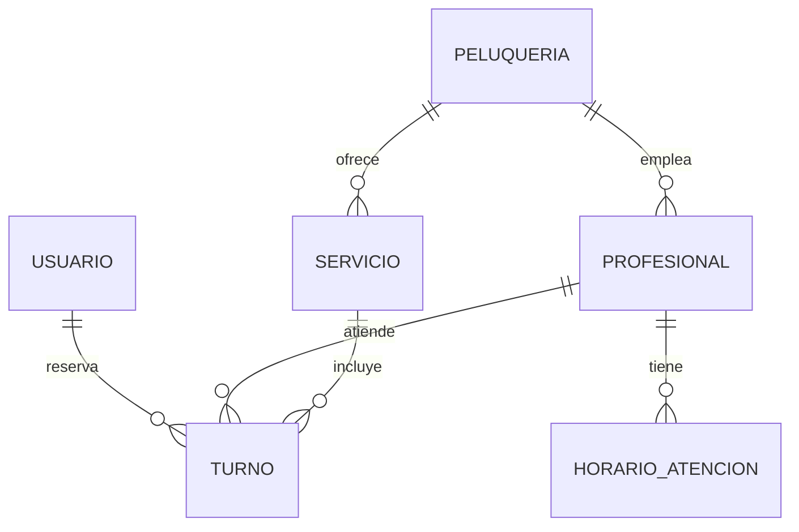

# 05-DATOS — ¿Qué información guarda?

## Entidades

### Usuario

| Campo | Tipo | Descripción |
|---|---|---|
| id | texto (UUID) | Identificador único |
| nombre | texto | Nombre y apellido |
| email | texto | Correo electrónico, único |
| contrasena_hash | texto | Contraseña cifrada |
| telefono | texto | Teléfono de contacto (opcional) |
| rol | texto | `cliente`, `dueno` o `profesional` |
| creado_en | fecha y hora | Fecha de registro |

### Peluqueria

| Campo | Tipo | Descripción |
|---|---|---|
| id | texto (UUID) | Identificador único |
| nombre | texto | Nombre del local |
| descripcion | texto | Presentación breve |
| direccion | texto | Dirección del local |
| telefono | texto | Teléfono del local |
| dueno_id | texto | Usuario dueño (relación con Usuario) |

### Servicio

| Campo | Tipo | Descripción |
|---|---|---|
| id | texto (UUID) | Identificador único |
| peluqueria_id | texto | Peluquería a la que pertenece |
| nombre | texto | Ej.: Corte de cabello |
| duracion_min | número entero | Duración en minutos |
| precio | número decimal | Precio en pesos (marcador: 0) |
| activo | verdadero/falso | Si se ofrece actualmente |

### Profesional

| Campo | Tipo | Descripción |
|---|---|---|
| id | texto (UUID) | Identificador único |
| peluqueria_id | texto | Peluquería en la que trabaja |
| usuario_id | texto | Usuario asociado (opcional) |
| nombre | texto | Nombre visible para el cliente |
| activo | verdadero/falso | Si recibe turnos actualmente |

### HorarioAtencion

| Campo | Tipo | Descripción |
|---|---|---|
| id | texto (UUID) | Identificador único |
| profesional_id | texto | Profesional al que corresponde |
| dia_semana | número entero | 0 = domingo … 6 = sábado |
| hora_inicio | texto (HH:MM) | Apertura |
| hora_fin | texto (HH:MM) | Cierre |

### Turno

| Campo | Tipo | Descripción |
|---|---|---|
| id | texto (UUID) | Identificador único |
| cliente_id | texto | Usuario que reserva |
| profesional_id | texto | Profesional elegido |
| servicio_id | texto | Servicio elegido |
| inicio | fecha y hora | Comienzo del turno |
| fin | fecha y hora | Fin calculado según la duración del servicio |
| estado | texto | `pendiente`, `confirmado`, `cancelado`, `atendido` o `ausente` |
| creado_en | fecha y hora | Fecha de la reserva |

## Relaciones



## Esquema de ejemplo (Prisma)

```prisma
model Turno {
  id            String   @id @default(uuid())
  clienteId     String
  profesionalId String
  servicioId    String
  inicio        DateTime
  fin           DateTime
  estado        String   @default("pendiente")
  creadoEn      DateTime @default(now())

  @@unique([profesionalId, inicio])
}
```

La restricción `@@unique([profesionalId, inicio])` evita dos turnos del mismo profesional
en el mismo horario (RNF06).

## Ejemplo de datos (ficticios)

```json
{
  "peluqueria": { "nombre": "Salón Ejemplo", "direccion": "Calle Falsa 123" },
  "servicio": { "nombre": "Corte de cabello", "duracion_min": 30, "precio": 0 },
  "profesional": { "nombre": "Profesional de Prueba" },
  "turno": {
    "inicio": "2026-11-05T15:00:00-03:00",
    "fin": "2026-11-05T15:30:00-03:00",
    "estado": "confirmado"
  }
}
```
