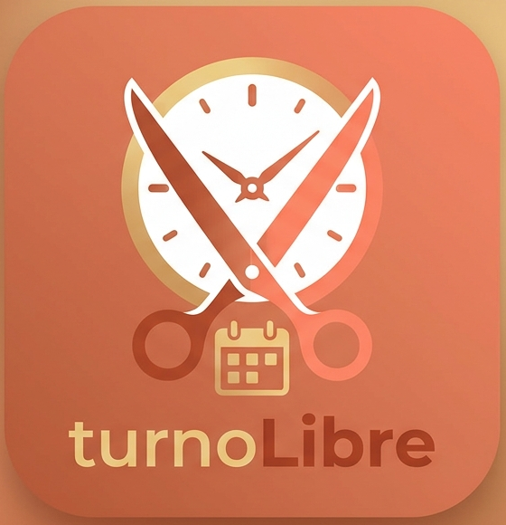

# IDENTIDAD-MARCA — ¿Cómo nos vemos y cómo hablamos?

## Esencia

| Elemento | Definición |
|---|---|
| **Nombre** | turnoLibre (se escribe todo junto, con la «L» de Libre en mayúscula) |
| **Eslogan** | Tu turno, sin vueltas. |
| **Misión** | Simplificar la reserva de turnos en peluquerías y barberías para que los clientes ahorren tiempo y los profesionales ordenen su agenda. |
| **Visión** | Ser la forma habitual en que las peluquerías independientes de Argentina gestionan sus turnos. |
| **Personalidad** | Cálida, cercana, clara, prolija y confiable. |
| **Público** | Clientes de 18 a 45 años que reservan desde el celular y dueños o encargados de peluquerías y barberías pequeñas. |

**Significado del nombre:** *turno* es la reserva de un horario y *libre* alude tanto al
horario disponible como a la libertad de agendar sin llamadas ni esperas. La «L» mayúscula
separa visualmente las dos palabras (turno + Libre) y se mantiene en toda comunicación.

## Logo

El logo combina un reloj (disponibilidad), unas tijeras cruzadas (peluquería) y un
calendario (gestión de turnos) dentro de un ícono de esquinas redondeadas.



| Versión | Archivo | Uso |
|---|---|---|
| Ícono con nombre (principal) | `marca/logo-turnolibre.png` | Portada, encabezado, redes sociales |
| Imagen original completa | `marca/logo-turnolibre-original.png` | Archivo de respaldo |
| Maqueta con paleta | `marca/logo-turnolibre-mockup.png` | Presentaciones y vista previa de marca |
| Paleta | `marca/paleta-turnolibre.png` | Referencia rápida de colores |

**Reglas de uso:** respetar el espacio libre alrededor del ícono, no deformarlo, no
cambiar sus colores y no apoyarlo sobre fondos que reduzcan el contraste.

## Paleta de colores

| Nombre | HEX | Uso |
|---|---|---|
| Terracota | `#D2694A` | Color principal: fondo del ícono, encabezados, acentos |
| Marrón profundo | `#A73F22` | Botones principales, texto «Libre», enlaces, estados activos |
| Dorado suave | `#E8C581` | Detalles, bordes, texto «turno», íconos secundarios |
| Blanco cálido | `#FFFFFF` | Tarjetas, texto sobre colores oscuros, ícono del reloj |
| Crema | `#FFF3E7` | Fondo general de las pantallas |
| Texto oscuro | `#3B1F17` | Texto de lectura sobre fondos claros |

> **Accesibilidad:** el texto blanco sobre `#A73F22` tiene buen contraste y se usa en los
> botones. El texto blanco sobre `#D2694A` se reserva para títulos grandes o en negrita.

## Tipografías

| Uso | Tipografía | Motivo |
|---|---|---|
| Títulos y botones | **Montserrat** (SemiBold / Bold) | Geométrica y moderna; coincide con el estilo del texto del logo |
| Texto general | **Open Sans** (Regular / SemiBold) | Muy legible en pantallas pequeñas |

```css
:root {
  --font-title: "Montserrat", sans-serif;
  --font-body: "Open Sans", sans-serif;
}
```

## Tono de voz

- **Cercano y rioplatense:** usamos voseo ("Sacá tu turno", "Elegí tu horario").
- **Claro y breve:** frases cortas, una idea por mensaje.
- **Amable, sin exagerar:** sin jerga técnica ni signos de exclamación en exceso.
- **Positivo ante los errores:** explicamos cómo resolver el problema.

| En lugar de… | Decimos… |
|---|---|
| "Error 409: conflicto de recurso" | "Ese horario ya fue reservado. Probá con otro." |
| "Reserva exitosa" | "¡Listo! Tu turno quedó confirmado." |
| "Debe iniciar sesión" | "Ingresá a tu cuenta para continuar." |
